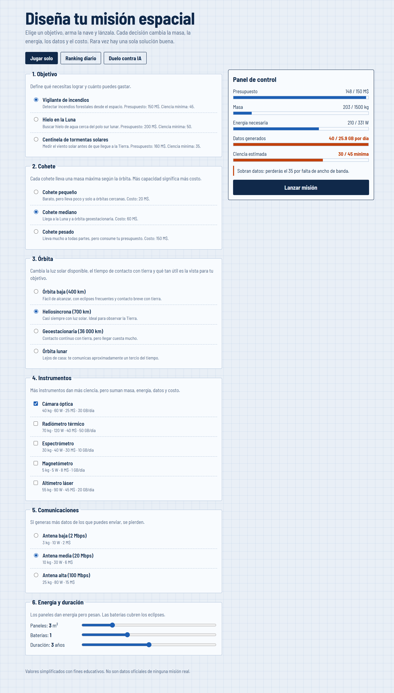
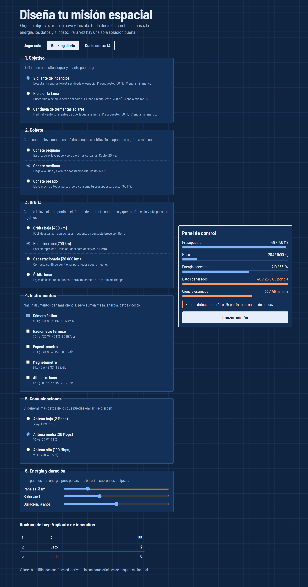

# Diseña tu misión espacial

Juego educativo para el **NASA Space Apps Challenge 2026**. Elegís un objetivo, armás la
nave y la lanzás. Cada decisión cambia la masa, la energía, los datos y el costo. Casi
nunca hay una sola solución buena.

Incluye tres modos:

- **Jugar solo** — diseñá y mirá el informe de tu misión.
- **Ranking diario** — publicá tu diseño y competí contra el resto del día.
- **Duelo contra IA** — enfrentate a un modelo de lenguaje (Groq) que diseña su propia nave.



## Cómo se juega

1. Elegí una **misión** (incendios, hielo lunar o tormentas solares).
2. Elegí el **cohete**, la **órbita** y los **instrumentos**.
3. Ajustá **área de paneles**, **baterías** y **años de vida útil**.
4. Lanzá y leé el **informe**: ciencia, energía, datos y costo.

Se ve bien en computadora y en celular, y respeta el modo claro/oscuro del sistema.

| Ranking diario | Duelo contra IA |
| --- | --- |
|  |  |

## Arquitectura

- **El juego** es un solo archivo `index.html` (HTML + CSS + JavaScript, sin dependencias).
  Se publica con GitHub Pages.
- **El Worker** (`worker.js`) corre en Cloudflare y hace dos cosas:
  - Habla con la IA (Groq) guardando la clave como secreto.
  - Guarda y lee el ranking diario en una caja **Cloudflare KV** (sin base de datos).

Si el juego no encuentra un Worker configurado, igual funciona en **modo local**
(ranking guardado en el propio navegador).

## Puesta en marcha

### 1. Juego (GitHub Pages)

El archivo `index.html` en la raíz ya queda publicado automáticamente al activar Pages
en el repositorio (rama `main`, carpeta raíz).

### 2. Worker + ranking (Cloudflare)

1. Creá una **KV namespace** llamada `ranking-misiones`.
2. Conectá este repositorio a un **Worker** de Cloudflare (integración con GitHub).
   Cloudflare toma `wrangler.toml` y publica `worker.js`.
3. Cargá el secreto **`GROQ_KEY`** con tu clave de Groq.
4. Agregá el enlace KV: variable **`RANKS`** → namespace `ranking-misiones`.
5. Copiá la URL del Worker (algo como `https://mision-espacial.<usuario>.workers.dev`).

### 3. Conectar el juego con el Worker

Pegá esa URL en `index.html`, en la línea:

```js
const CFG={WORKER:"https://mision-espacial.<usuario>.workers.dev"};
```

Guardá, subí el cambio y listo: el ranking y los rivales de IA quedan compartidos.

> Guía paso a paso, sin tecnicismos: ver [`DEPLOY.md`](DEPLOY.md).

## Modelos de IA

Los rivales usan modelos vigentes de Groq: `openai/gpt-oss-120b`, `qwen/qwen3.8-27b` y
`openai/gpt-oss-20b`.

## Aviso

Valores simplificados con fines educativos. No son datos oficiales de ninguna misión real.
